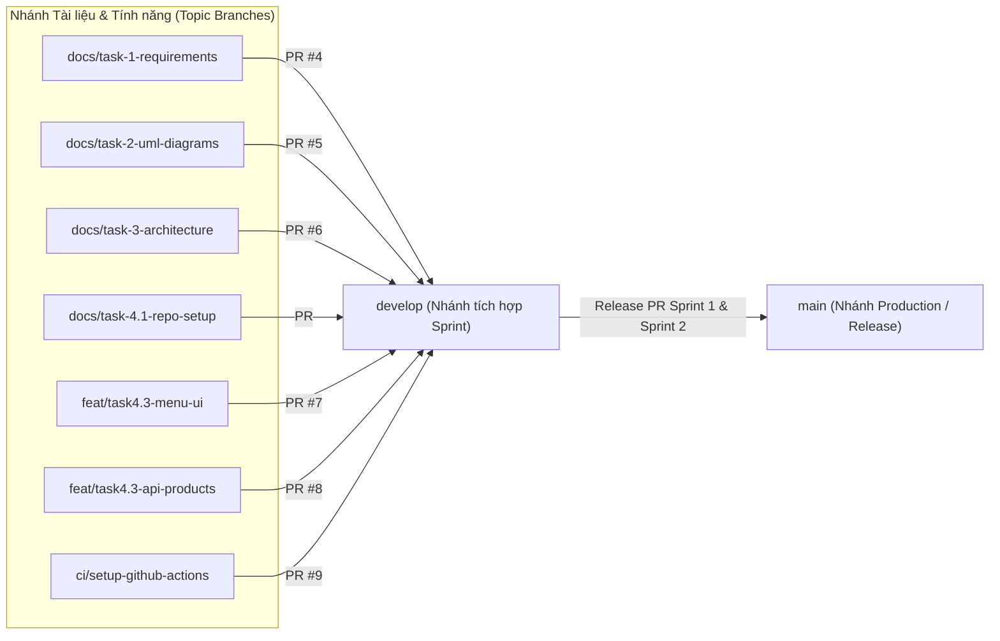

# Quy Trình Phát Triển, Quản Lý Nhánh, Pull Request, Commit & Definition of Done (Task 4.1)

- **Dự án:** BrewLite – Nền tảng đặt đồ uống không dùng tiền mặt (Assignment 2)
- **Môn học:** Công nghệ Phần mềm – Khoa Công nghệ Thông tin, Trường Đại học Sài Gòn
- **Phạm vi áp dụng:** Toàn bộ thành viên nhóm phát triển trong Sprint 1 và Sprint 2

---

## 1. Chiến Lược Quản Lý Nhánh (Branching Strategy)

Dự án **BrewLite** áp dụng mô hình **Gitflow rút gọn (Simplified Gitflow)** trên kho mã nguồn Monorepo để đảm bảo nhánh chính luôn ổn định, dễ dàng kiểm soát phiên bản tài liệu (Task 4.2) và tích hợp tự động với CI/CD Pipeline (Task 4.4 & Task 5.3).

### 1.1. Các Nhánh Cố Định (Long-lived Branches)

| Tên nhánh | Vai trò & Mục đích | Quy tắc bảo vệ nhánh (Branch Protection Rules) |
| :--- | :--- | :--- |
| **`main`** | Nhánh **Production** chính thức. Chứa mã nguồn và tài liệu đã hoàn thiện, ổn định ở cuối mỗi Sprint/Release. | - Cấm push trực tiếp (`direct push`).<br>- Chỉ nhận merge từ nhánh `develop` (hoặc `hotfix/*`) thông qua Pull Request.<br>- Bắt buộc vượt qua CI Quality Gate (`Lint`, `Test`, `Build`). |
| **`develop`** | Nhánh **Tích hợp (Integration)** trung tâm của Sprint. Mọi nhánh công việc đều tách ra từ `develop` và gộp ngược về `develop`. | - Cấm push trực tiếp khi làm tính năng.<br>- Bắt buộc mở Pull Request, có ít nhất 1 thành viên review và vượt qua toàn bộ kiểm tra tự động của CI. |

### 1.2. Các Nhánh Công Việc Ngắn Hạn (Short-lived / Topic Branches)

Mỗi thành viên khi nhận task trên Issue Board phải tạo nhánh mới từ `develop` theo quy ước đặt tên:

```text
<loại-nhánh>/<mã-task-hoặc-phạm-vi>-<mô-tả-ngắn-gọn-kebab-case>
```

| Tiền tố nhánh | Mục đích sử dụng | Ví dụ nhánh thực tế trong Repository |
| :--- | :--- | :--- |
| **`docs/*`** | Xây dựng và cập nhật tài liệu yêu cầu (Task 1), sơ đồ UML (Task 2), thiết kế kiến trúc & ADR (Task 3), ma trận truy vết. | `docs/task-1-requirements`<br>`docs/task-2-uml-diagrams`<br>`docs/task-3-architecture` |
| **`feat/*`** | Phát triển tính năng mới cho Frontend (`apps/web`) hoặc Backend (`apps/api`) trong Sprint 1 và Sprint 2. | `feat/task4.3-api-products`<br>`feat/task4.3-menu-ui`<br>`feat/task5.1-cart-checkout` |
| **`fix/*`** | Sửa lỗi phát sinh trong quá trình phát triển hoặc kiểm thử tích hợp. | `fix/ui-remove-external-css`<br>`fix/order-stock-concurrency` |
| **`test/*`** | Bổ sung hoặc nâng cấp các bộ kiểm thử Unit, Integration và E2E. | `test/task4.3-unit-integration`<br>`test/task5.2-e2e-checkout` |
| **`ci/*`** | Thiết lập và cấu hình pipeline GitHub Actions (CI/CD), Docker. | `ci/setup-github-actions`<br>`ci/cd-production-pipeline` |
| **`hotfix/*`** | Khắc phục sự cố khẩn cấp trực tiếp từ nhánh `main` trên môi trường Production. | `hotfix/payment-webhook-timeout` |

### 1.3. Sơ Đồ Luồng Phân Nhánh & Gộp Nhánh



---

## 2. Quy Trình Pull Request (Pull Request Workflow)

Mọi thay đổi đối với mã nguồn (`apps/web`, `apps/api`, `tests`) cũng như tài liệu đặc tả, sơ đồ UML và kiến trúc (`docs/`) **bắt buộc phải đi qua Pull Request (PR)** và ghi rõ lý do thay đổi (tuân thủ nghiêm ngặt mục **6.2 Task 4.2 – Quản lý tài liệu** và **6.4 Task 4.4 – Continuous Integration**).

### 2.1. Các Bước Thực Hiện Một Pull Request

1. **Đồng bộ nhánh mới nhất:**
   ```bash
   git checkout develop
   git pull origin develop
   git checkout -b feat/task4.3-ten-tinh-nang
   ```
2. **Hiện thực & Kiểm tra cục bộ (Local Pre-check):**
   Trước khi đẩy code lên GitHub, lập trình viên bắt buộc chạy kiểm tra tại máy local:
   ```bash
   npm run lint
   npm run test
   npm run build
   ```
3. **Tạo Pull Request theo mẫu chuẩn (`.github/pull_request_template.md`):**
   - Đặt tiêu đề PR theo chuẩn: `[Task X.Y] <Mô tả ngắn gọn nội dung PR>` hoặc theo chuẩn Conventional Commit.
   - Điền rõ: **Mục tiêu/Lý do thay đổi**, **Liên kết mã yêu cầu (`FR-xx`, `NFR-xx`) / Issue ID (`#S1-xx`, `#S2-xx`)**, và đánh dấu đầy đủ vào **Checklist Definition of Done**.
4. **Kiểm tra Tự động qua CI Quality Gate:**
   Khi PR được mở hoặc có commit mới đẩy lên, GitHub Actions tự động kích hoạt luồng:
   $$\text{Install} \longrightarrow \text{Lint} \longrightarrow \text{Unit Test} \longrightarrow \text{Build}$$
   > [!IMPORTANT]
   > **Quy tắc bắt buộc:** Pull Request tuyệt đối **không được phép merge** nếu bất kỳ bước nào trong pipeline `Lint`, `Unit Test` hoặc `Build` thất bại.
5. **Code Review & Merge:**
   - Ít nhất **01 thành viên khác** trong nhóm kiểm tra tính đúng đắn của logic, độ phủ test và tính đồng bộ với tài liệu thiết kế.
   - Sau khi được `Approve` và CI báo xanh (`All checks have passed`), thực hiện merge vào nhánh `develop`.

---

## 3. Quy Ước Commit (Commit Message Convention)

Nhóm áp dụng chuẩn **Conventional Commits** để lịch sử Git rõ ràng, dễ dàng truy vết theo từng Task và tự động tổng hợp Release Notes ở Task 5.4.

### 3.1. Cấu Trúc Bản Tin Commit

```text
<type>(<scope>): <mô tả ngắn gọn thay đổi>
```

### 3.2. Phân Loại `<type>` và `<scope>`

| `<type>` | Ý nghĩa sử dụng | Ví dụ `<scope>` thường dùng |
| :--- | :--- | :--- |
| **`feat`** | Thêm mới một tính năng nghiệp vụ hoặc API/UI component. | `api`, `web`, `menu`, `cart`, `auth`, `order`, `payment`, `task-4.3`, `task-5.1` |
| **`fix`** | Sửa lỗi logic, lỗi giao diện hoặc lỗi cấu hình. | `ui`, `menu`, `api`, `prisma`, `validation` |
| **`docs`** | Thêm mới hoặc cập nhật tài liệu SRS, Use-case, UML, ADR, README, Backlog. | `srs`, `uml`, `arch`, `adr`, `readme`, `backlog`, `traceability`, `task-4.1` |
| **`test`** | Thêm mới hoặc chỉnh sửa Unit test, Integration test, E2E test. | `api`, `web`, `e2e`, `task-4.3`, `task-5.2` |
| **`ci`** | Thiết lập hoặc chỉnh sửa GitHub Actions workflows (`.github/workflows/*`), Docker. | `actions`, `docker`, `pipeline`, `task-4.4`, `task-5.3` |
| **`refactor`** | Tái cấu trúc mã nguồn mà không làm thay đổi hành vi nghiệp vụ bên ngoài. | `products`, `orders`, `store` |
| **`chore`** | Cập nhật cấu hình dự án, dependencies (`package.json`), `.gitignore`, `.env.example`. | `deps`, `config`, `monorepo` |

### 3.3. Quy Tắc Viết Commit & Ví Dụ Thực Tế Trong Dự Án

- **Ngôn ngữ:** Thống nhất sử dụng tiếng Anh hoặc tiếng Việt có dấu rõ ràng, viết ở thể mệnh lệnh (imperative mood), không vượt quá 100 ký tự ở dòng tiêu đề.
- **Mỗi commit thực hiện một thay đổi có ý nghĩa (Atomic Commit):** Không gộp các thay đổi không liên quan vào một commit mơ hồ.
- **Ví dụ hợp lệ (trích từ lịch sử Git của dự án):**
  - `feat(api): setup PostgreSQL, Prisma Product/Ingredient models, and seed script`
  - `feat(api): implement GET /products/:id endpoint (Task 4.3)`
  - `feat(menu): integrate MenuSkeleton, EmptySate and ErrorAlert into menu page`
  - `fix(ui): remove external css dependencies in MenuSkeleton, EmptyState, and ErrorAlert`
  - `test(task-4.3): add unit, integration, and component tests for MVP sprint 1`
  - `docs(srs): fix math formatting in FR-08 order state transition`
  - `docs(arch): gộp kiến trúc frontend-backend vào overview và chuẩn hóa ADR 001-004`

---

## 4. Định Nghĩa Hoàn Thành – Definition of Done (DoD)

Một hạng mục công việc (Backlog Item / User Story / Task) trên Issue Board chỉ được phép kéo sang cột **`Done`** khi thỏa mãn **100% các tiêu chí** ở cấp độ tương ứng dưới đây:

### 4.1. DoD cho Hạng Mục Tài Liệu & Mô Hình Hóa (Task 1, Task 2, Task 3, Task 4.2)

- [x] Nội dung đầy đủ theo đúng yêu cầu của đề bài (bảng Stakeholder, In/Out-of-scope, SRS có mã `FR-xx`/`NFR-xx` kèm mức ưu tiên MoSCoW và Acceptance Criteria kiểm chứng được).
- [x] Đối với sơ đồ UML (Use-case, Activity, Sequence, Class, Deployment): Lưu trữ **cả tệp mã nguồn PlantUML (`.puml`) và ảnh kết xuất (`.svg`)** trong thư mục `docs/diagrams/`.
- [x] Không có sự mâu thuẫn giữa SRS, đặc tả Use-case, các sơ đồ UML, mô hình cơ sở dữ liệu Prisma và kiến trúc C4/ADR.
- [x] Mọi chỉnh sửa tài liệu đều đi qua commit/Pull Request có ghi rõ lý do thay đổi.

### 4.2. DoD cho Một User Story / Tính Năng Kỹ Thuật (Task 4.3, Task 5.1, Task 5.2)

- [x] **Đáp ứng Nghiệp vụ:** Thỏa mãn toàn bộ Tiêu chí chấp nhận (Acceptance Criteria) của mã yêu cầu `FR-xx` / `NFR-xx` tương ứng trong `docs/requirements/srs.md`.
- [x] **Chuẩn Giao diện Frontend (`apps/web`):**
  - Thiết kế chuẩn Mobile-First (`375px - 430px`) và tương thích Desktop, không vỡ bố cục.
  - Xử lý đầy đủ 4 trạng thái giao diện: **`loading`** (Skeleton/Spinner), **`empty`** (EmptyState), **`error`** (ErrorAlert kèm nút thử lại) và **`success`**.
- [x] **Chuẩn API & Bảo mật Backend (`apps/api`):**
  - Mọi dữ liệu đầu vào (DTO) được kiểm tra qua `ValidationPipe` (`class-validator`).
  - Các API nhạy cảm (Đặt đơn, Thanh toán, Lịch sử đơn) được bảo vệ bởi `JwtAuthGuard`.
  - Xử lý giao dịch an toàn bằng Database Transaction (`Prisma.$transaction`) và đảm bảo `Idempotency` cho thanh toán.
  - Không để lộ secret, khóa API hoặc mật khẩu trong mã nguồn hay log.
- [x] **Kiểm thử Tự động (Automated Testing):**
  - Có đầy đủ Unit Test và Integration/Component Test cho luồng chính và các nhánh lỗi (`400`, `401`, `404`, `409`).
  - Toàn bộ test suites chạy thành công (`npm run test` đạt 100% PASS).
- [x] **Quality Gate & CI:**
  - Vượt qua toàn bộ các bước trong CI Pipeline trên GitHub Actions: `Install` $\rightarrow$ `Lint` (`0 errors`) $\rightarrow$ `Unit Test` $\rightarrow$ `Build`.
- [x] **Truy vết (Traceability):**
  - Đã cập nhật ánh xạ từ `Mã yêu cầu` $\rightarrow$ `Use-case/User Story` $\rightarrow$ `Sơ đồ thiết kế` $\rightarrow$ `Code/API` $\rightarrow$ `Mã Test` vào tệp [`docs/traceability-matrix.md`](./traceability-matrix.md).

### 4.3. DoD cho Cấp Độ Sprint (Sprint 1 & Sprint 2)

- [x] **Sprint 1:**
  - Hoàn thành toàn bộ tạo phẩm của Task 1, Task 2, Task 3 trong thư mục `docs/`.
  - Repository có đầy đủ cấu trúc `apps/web`, `apps/api`, `docs`, `README.md`, `.gitignore`, `.env.example`, quy trình Branch/PR/Commit/DoD và Product Backlog 2 Sprint.
  - MVP Sprint 1 chạy được thực tế: API `GET /products` & `GET /products/:id`, màn hình Menu Mobile-First có trạng thái `loading`/`empty`/`error`, có database seed và vượt qua 21/21 test cases.
  - Pipeline CI tự động chạy khi mở PR và chặn merge nếu lint/test/build lỗi.
- [x] **Sprint 2:**
  - Hoàn thiện toàn bộ luồng End-to-End: Xem menu $\rightarrow$ Chọn Size/Topping $\rightarrow$ Giỏ hàng $\rightarrow$ Đăng ký/Đăng nhập JWT $\rightarrow$ Đặt đơn $\rightarrow$ Thanh toán (Ví/Thẻ/VietQR có Idempotency) $\rightarrow$ Theo dõi & Lịch sử đơn.
  - Có đầy đủ Unit test, Integration test, ít nhất 01 End-to-End (E2E) test, `docker-compose.yml` chạy trọn vẹn 3 dịch vụ (Web, API, DB) ở local và endpoint `GET /health`.
  - Pipeline Continuous Delivery (CD) tự động build Docker image, push registry, chạy migration an toàn, deploy lên Production (HTTPS), chạy Smoke Test và hỗ trợ Rollback.
  - Bàn giao đầy đủ URL Production, Release Notes, Video Demo và báo cáo Sprint Review / Retrospective.

